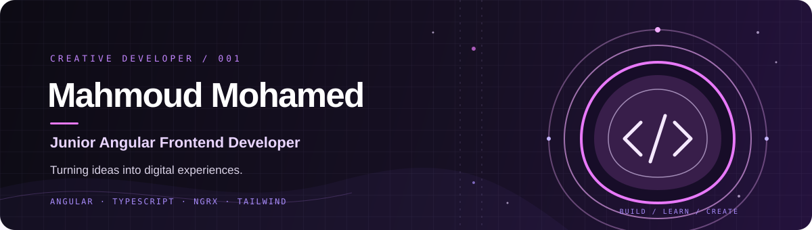

<div align="center">
  
</div>
---

## `01 / About Me`

```typescript
const mahmoud = {
  role: "Junior Angular Frontend Developer",

  interests: [
    "Creative Web Development",
    "Responsive User Interfaces",
    "Reusable Components",
    "Frontend Architecture",
  ],

  technologies: [
    "Angular",
    "TypeScript",
    "RxJS",
    "NgRx",
    "Tailwind CSS",
  ],

  currentlyLearning: [
    "Advanced Angular",
    "Unit Testing",
    "Frontend Best Practices",
  ],

  philosophy: "Build. Learn. Create. Repeat.",
};
```

I'm a **Junior Angular Frontend Developer** passionate about building modern web applications and crafting meaningful user experiences.

I enjoy transforming designs into functional interfaces, creating reusable components, working with APIs, and writing maintainable frontend code.

I'm continuously exploring new technologies and improving my problem-solving and development skills.

---

## `02 / Tech Stack`

<div align="center">

**01 — Frontend Development**


<br/><br/>

**02 — UI & Styling**


<br/><br/>

**03 — State & Reactive Programming**


<br/><br/>

**04 — Development Tools**


</div>

---

## `03 / Featured Projects`

<div align="center">

*Some things I've been building.*

</div>

<table>
<tr>
<td width="50%" valign="top">

### 01. Online Exam

An online examination frontend project focused on interactive examination experiences.

**Technologies**


<br/>

<a href="https://github.com/Dev-Mahmoud28/online-exam">↗ Explore Repository</a>

</td>
<td width="50%" valign="top">

### 02. Rose E-commerce

A collaborative e-commerce frontend project featuring reusable UI components and modern Angular architecture.

**Technologies**


<br/>

<a href="https://github.com/nabdelfattah/rose-app">↗ Explore Repository</a>

</td>
</tr>
<tr>
<td colspan="2" align="center">

### 03. E-commerce

An e-commerce web development project.

<a href="https://github.com/Dev-Mahmoud28/E-commerce">↗ Explore Repository</a>

</td>
</tr>
</table>

---

## `04 / GitHub Analytics`

<div align="center">


<br/><br/>


</div>
---

## `05 / Let's Connect`

<div align="center">

### Let's build something meaningful.

<a href="https://github.com/Dev-Mahmoud28">

</a>
<a href="https://www.linkedin.com/in/mahmoud-mohamed-094935241/">

</a>

<br/><br/>

*Turning curiosity into code, and ideas into experiences.*

<br/>


</div>
